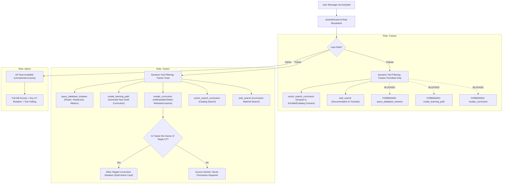

# AI Assistant Autonomous Tool Calling & Strict RBAC Implementation Plan

## 1. Problem Statement & Architecture Evolution

### The Traditional Approach (Current System)
Currently, in `backend/src/databaseOrm/modules/trainerAiAssistant/trainerAiIntent.service.ts` and `backend/src/mcp/mcp-bridge.service.ts`:
- When a user submits an inquiry (e.g. *"search all the trainee inside the Database"*), the system evaluates 7 regex patterns (`TRAINEE_PATTERNS`) and runs manual string extractors (`extractTraineeQueryParams`).
- If matched, an intent is hardcoded as `'trainee_query'`.
- This is brittle, breaks on natural language variations or Hinglish, cannot handle blended questions, and violates modern AI agent engineering practices.

### The Modern Industry-Standard Architecture
- We introduce **Native Autonomous LLM Tool Calling (Function Calling)** using Groq / Llama 3.3 function calling APIs.
- The LLM itself decides which tool to call (`query_database_trainees`, `vector_search_curriculum`, `web_search`, `create_learning_path`, `mutate_curriculum`), automatically parses structured parameters into JSON, and synthesizes natural responses.
- **Strict Role-Based Access Control (RBAC) & Ownership**:
  - **Trainee**: Strictly restricted from creating courses, modifying courses, or querying any trainee records from the database. Allowed only conceptual learning assistance, assigned curriculum vector search, and web search for learning materials.
  - **Trainer**: Can query trainee records, create new learning paths, perform vector/web searches. Can **ONLY** modify/upgrade a Learning Path if they are the designated **owna
  - **Admin**: Full, unrestricted administrative access across all tools and all Learning Paths.
- **Zero Disruption Guarantee**:
  - The frontend action card structure (`TrainerActionCard.tsx`) with "Preview in Studio", "Confirm & Apply", and "Cancel" buttons remains 100% compatible.
  - Trainee assignment and lesson chat remain completely intact.

---

## 2. Remind & Reframe: Assistant Access Matrix by User Role



### Comprehensive Access Matrix

| Capability / Tool | Trainee | Trainer (Non-Owner) | Trainer (Owner) | Admin |
|---|:---:|:---:|:---:|:---:|
| **Ask Assignment & Lesson Questions** | :white_check_mark: Allowed | :white_check_mark: Allowed | :white_check_mark: Allowed | :white_check_mark: Allowed |
| **Search Curriculum Concepts (`vector_search`)** | :white_check_mark: Allowed | :white_check_mark: Allowed | :white_check_mark: Allowed | :white_check_mark: Allowed |
| **Search Technical Web Docs / Videos (`web_search`)** | :white_check_mark: Allowed | :white_check_mark: Allowed | :white_check_mark: Allowed | :white_check_mark: Allowed |
| **Query Trainees / Student DB (`query_database_trainees`)** | :x: **FORBIDDEN** | :white_check_mark: Allowed | :white_check_mark: Allowed | :white_check_mark: Allowed |
| **Create New Learning Path (`create_learning_path`)** | :x: **FORBIDDEN** | :white_check_mark: Allowed | :white_check_mark: Allowed | :white_check_mark: Allowed |
| **Upgrade / Modify LP (`mutate_curriculum`)** | :x: **FORBIDDEN** | :x: **FORBIDDEN** (Ownership required) | :white_check_mark: Allowed | :white_check_mark: Allowed |
| **Confirm / Cancel Staged Actions** | :x: **FORBIDDEN** | :x: **FORBIDDEN** | :white_check_mark: Allowed (own drafts) | :white_check_mark: Allowed |

---

## 3. Two-Tier Defense Architecture (Zero Vulnerability Guarantee)

1. **Tier 1 — Dynamic Tool Filtering (Prompt / LLM Level)**:
   - When the user sends a message, backend determines `currentUser.role`.
   - If user is `Trainee`:
     - Tools passed to LLM: `[vector_search_curriculum, web_search]`.
     - Administrative tools (`query_database_trainees`, `create_learning_path`, `mutate_curriculum`) are completely omitted from the request payload sent to the LLM.
     - If the trainee prompts *"Search all trainees"* or *"Create a course"*, the LLM has no tool declaration for it and politely responds that it cannot execute administrative actions.
   - If user is `Trainer`:
     - Tools passed to LLM: `[query_database_trainees, create_learning_path, mutate_curriculum, vector_search_curriculum, web_search, manage_pending_action]`.

2. **Tier 2 — Runtime Ownership & Permission Validator (Backend Execution Level)**:
   - Even if a tool call is executed, the backend tool dispatcher enforces programmatic authorization:
     - `query_database_trainees`: Checks `if (role === 'Trainee') throw new ForbiddenException()`.
     - `create_learning_path`: Checks `if (role === 'Trainee') throw new ForbiddenException()`.
     - `mutate_curriculum`: Resolves target `LearningPathEntity`. Checks:
       ```typescript
       const isOwner = targetLp.createdById === currentUserId || isAdmin;
       if (!isOwner) {
         return "Access Denied: You cannot modify this Learning Path because you are not its designated owner.";
       }
       ```

---

## 4. Step-by-Step Working Flow & Implementation Checklist

### Phase 1: Tool Registry & Role-Based Filtering
- [x] **Step 1.1**: Create `backend/src/databaseOrm/modules/trainerAiAssistant/tools/trainerTools.registry.ts`
  - Define OpenAI/Groq compatible JSON Schemas for:
    - `query_database_trainees`: DB search for student records, headcount, and activity metrics.
    - `create_learning_path`: AI curriculum generator from requirements prompt.
    - `mutate_curriculum`: Structural edits (add/remove/update modules, lessons, resources).
    - `vector_search_curriculum`: Semantic search over internal lessons and catalog.
    - `web_search`: External technical web search (Tavily/YouTube).
    - `manage_pending_action`: Confirmation/cancellation of staged actions.
- [x] **Step 1.2**: Implement `getToolsForRole(role: string)` filter function
  - Returns only safe tools for `Trainee`.
  - Returns trainer tools for `Trainer`.
  - Returns all tools for `Admin`.

### Phase 2: Autonomous Agent Dispatcher & Execution Engine
- [x] **Step 2.1**: Create `backend/src/databaseOrm/modules/trainerAiAssistant/trainerAgent.service.ts`
  - Implement autonomous agent loop communicating with Groq Chat Completions API with `tools` and `tool_choice: 'auto'`.
  - When LLM returns `tool_calls`, extract call ID, tool name, and parse JSON arguments.
  - Implement maximum iteration guardrail (max 3 tool turns per user prompt).
- [x] **Step 2.2**: Implement Tool Dispatch Handlers:
  - Wire `query_database_trainees` to `PostgresMcpService.queryTrainees()`.
  - Wire `vector_search_curriculum` to `AiAssistantRetrievalService`.
  - Wire `web_search` to external search/Tavily provider.
- [x] **Step 2.3**: Format tool outputs into `role: 'tool'` messages and feed back into LLM for final synthesis.

### Phase 3: Runtime Ownership Guard & Staged Action Compatibility
- [x] **Step 3.1**: In `mutate_curriculum` tool handler:
  - Load `LearningPathEntity` with `createdBy` relation.
  - Verify ownership: `targetLp.createdBy?.id === trainerId || isAdmin`.
  - If not owner, return explicit access denied response to LLM.
- [x] **Step 3.2**: In `create_learning_path` and `mutate_curriculum`:
  - Invoke `TrainerLpGenerationService` / `TrainerLpUpgradeService`.
  - Create pending `TrainerActionEntity` with `status: 'pending'`.
  - Generate the identical `actionCard` payload (`actionId`, `type`, `lpId`, `lpTitle`, `summary`, `diff`) required by `TrainerActionCard.tsx`.

### Phase 4: Integration & Regex Deprecation
- [x] **Step 4.1**: Update `trainerAiAssistant.service.ts`:
  - Route user query through `trainerAgent.service.ts`.
  - Deprecate manual regex intent checks (`TRAINEE_PATTERNS`, `extractTraineeQueryParams`).
- [x] **Step 4.2**: Verify that conversation history and multi-turn state (`TrainerConversationEntity`, `TrainerMessageEntity`) remain intact.

### Phase 5: Verification, Validation & Build Checks
- [x] **Step 5.1**: Test Trainee Query Restrictions
  - Query: *"search all trainees in the database"* $\rightarrow$ Tool not exposed, polite refusal.
  - Query: *"create a 3-module DevOps course"* $\rightarrow$ Tool not exposed, polite refusal.
  - Query: *"explain CI/CD pipeline principles"* $\rightarrow$ Allowed (`vector_search_curriculum`), clear conceptual answer.
- [x] **Step 5.2**: Test Trainer Database Queries
  - Query: *"search all the trainee inside the Database"* $\rightarrow$ LLM calls `query_database_trainees(status='all')`, formats roster.
  - Query: *"how many inactive students do we have?"* $\rightarrow$ LLM calls `query_database_trainees(status='inactive', count_only=true)`.
- [x] **Step 5.3**: Test Trainer Ownership Enforcement
  - Query: *"In my course [Owned Course], add a Docker lesson"* $\rightarrow$ Allowed, generates staged action card.
  - Query: *"In course [Other Trainer's Course], delete module 1"* $\rightarrow$ Rejection: *"Access Denied: You cannot modify this Learning Path because you are not its designated owner."*
- [x] **Step 5.4**: Test Admin Full Access
  - Query: Modifying any course $\rightarrow$ Allowed regardless of ownership.
- [x] **Step 5.5**: Full Clean Build Verification
  - `npm --prefix backend run build` (0 errors)
  - `npm --prefix frontend run build` (0 errors)

---

## 5. Summary of Deliverables & Expected Outcome

| Component | Before Upgrade | After Upgrade |
|---|---|---|
| **Query Routing** | 7 Hardcoded Regexes + Manual String Extractors | Native LLM Autonomous Tool Calling |
| **RBAC Enforcement** | Partial / Implicit | Two-Tier (Prompt Filter + Backend Runtime Validator) |
| **Ownership Gate** | Hardcoded in intent conditional | Integrated into autonomous tool execution handler |
| **Trainee Protection** | Can attempt prompt leaks | Administrative tools completely omitted from LLM prompt |
| **Frontend UI Compatibility** | Interactive Action Cards | 100% Preserved (`TrainerActionCard.tsx`) |

